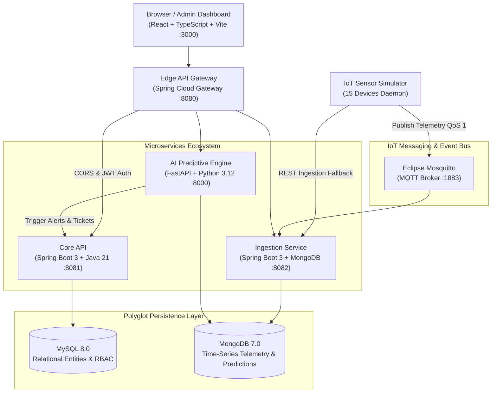

# Smart IoT Park Platform

[](https://github.com/xSenitha/smart-iot-park-platform/actions/workflows/ci.yml)
[](LICENSE)
[](https://www.oracle.com/java/)
[](https://spring.io/projects/spring-boot)
[](https://www.python.org/)
[](https://fastapi.tiangolo.com/)
[](https://react.dev/)
[](https://www.docker.com/)

> **A production-grade, distributed microservices platform for municipal park management, real-time IoT sensor telemetry ingestion, and AI-driven predictive maintenance.** Built for urban city planners, municipal operations, and field dispatch crews.

---

## 🏗️ Architecture Overview

The platform uses a decoupled microservices architecture with **polyglot persistence**, **event-driven MQTT messaging**, and a **centralized perimeter gateway**:



---

## 🧩 Microservices Ecosystem

| Service | Directory | Stack | Port | Responsibilities |
|---|---|---|---|---|
| **Core API** | `services/core-api` | Java 21, Spring Boot 3, MySQL 8, Flyway, Spring Security 6 | `8081` | Relational domain entities, JWT RBAC, park/zone registry, alert management, maintenance work orders, and SSE real-time event streaming. |
| **Ingestion Service** | `services/ingestion-service` | Java 21, Spring Boot 3, MongoDB 7, Paho MQTT | `8082` | High-throughput telemetry ingestion over MQTT QoS 1 and REST, range validation, device heartbeat sync, and historical time-series queries. |
| **AI Engine** | `services/ai-engine` | Python 3.12, FastAPI, Scikit-Learn, PyMongo | `8000` | Machine learning forecasting (bin overflow EWMA, multivariate z-score anomaly detection, botanical irrigation optimization, scheduled batch inference). |
| **API Gateway** | `services/api-gateway` | Java 21, Spring Cloud Gateway (Netty) | `8080` | Unified edge entry point, JWT signature validation, token bucket rate limiting, and CORS routing. |
| **Sensor Simulator** | `services/sensor-simulator` | Python 3.12, Eclipse Paho | N/A | Simulates 15 physical IoT devices (compact bins, agronomic soil probes, intelligent lighting) across 3 park zones with realistic diurnal curves and fault injection. |
| **Admin Dashboard** | `frontend/dashboard` | React 18, TypeScript, Vite, Custom CSS Design System | `3000` | Interactive SVG park and zone spatial map, real-time telemetry curves, incident alert center, maintenance work orders Kanban desk, and role switcher. |
| **Infrastructure & AWS** | `infra/` | Docker Compose, Mosquitto, Prometheus, Grafana, Terraform | `1883, 3001, 9090` | Container orchestration, full Prometheus & Grafana operational dashboards, and AWS Terraform IaC modules. |

---

## 🚀 Quick Start (Local Docker Stack)

### Prerequisites
- Docker Engine 24+ & Docker Compose v2
- Java 21 JDK (optional, for local development)
- Node.js 20+ & Python 3.12+ (optional, for local development)

### 1. Clone & Configure
```bash
git clone https://github.com/xSenitha/smart-iot-park-platform.git
cd smart-iot-park-platform
cp .env.example .env
```

### 2. Start Full Platform
Using Make:
```bash
make up
```
Or directly with Docker Compose:
```bash
docker compose up -d --build
```

### 3. Access Platform Interfaces
- **Admin Dashboard**: [http://localhost:3000](http://localhost:3000)
- **API Gateway**: [http://localhost:8080](http://localhost:8080)
- **Core API Swagger UI**: [http://localhost:8081/swagger-ui.html](http://localhost:8081/swagger-ui.html)
- **AI Engine Docs**: [http://localhost:8000/docs](http://localhost:8000/docs)
- **Grafana Observability**: [http://localhost:3001](http://localhost:3001) (`admin` / `admin`)
- **Prometheus Metrics**: [http://localhost:9090](http://localhost:9090)

---

## 🧪 Comprehensive Test Suite

Every microservice in this repository contains a complete automated test suite without stubs:

```bash
# 1. Core API (JUnit 5 + Mockito - 12 tests)
cd services/core-api && ./mvnw test

# 2. Ingestion Service (JUnit 5 + MockMvc - 10 tests)
cd services/ingestion-service && ./mvnw test

# 3. API Gateway (Reactive Netty & Filter Tests - 6 tests)
cd services/api-gateway && ./mvnw test

# 4. AI Engine (ML Regression & API Tests - 18 tests)
cd services/ai-engine && python -m unittest discover -s tests -v

# 5. Sensor Simulator (Diurnal Math & Fault Injection - 5 tests)
cd services/sensor-simulator && python -m unittest discover -s tests -v

# 6. Frontend Dashboard (Vitest + React Testing Library - 3 tests)
cd frontend/dashboard && npm test
```

---

## ☁️ AWS Cloud Deployment (Terraform)

The platform includes production-ready Terraform IaC in `infra/terraform/`:
- **VPC & Subnets**: Multi-AZ public and private subnets, Internet Gateway, and route tables.
- **Security Groups**: Tight least-privilege firewall rules for ALB, EC2 microservices host, and private RDS.
- **RDS MySQL 8.0**: Multi-AZ automated backups, storage autoscaling, and encrypted storage.
- **EC2 Container Host**: Ubuntu 22.04 LTS instance with IAM Systems Manager (SSM) access and automated Docker bootstrap script (`user_data.sh`).

For detailed provisioning steps, see the [AWS Deployment Runbook](docs/runbooks/aws-deployment.md).

---

## 📐 Architecture Decision Records (ADRs)

Key architectural decisions are documented under `docs/adr/`:
- [ADR 0001: Microservices & Polyglot Persistence (MySQL + MongoDB)](docs/adr/0001-microservices-polyglot-persistence.md)
- [ADR 0002: MQTT Edge Messaging & Server-Sent Events (SSE)](docs/adr/0002-mqtt-sse-realtime-telemetry.md)
- [ADR 0003: Statistical Machine Learning for Predictive Maintenance](docs/adr/0003-hybrid-ai-predictive-maintenance.md)
- [ADR 0004: API Gateway Perimeter Routing, JWT Auth & Rate Limiting](docs/adr/0004-api-gateway-perimeter-security.md)

---

## 📄 License
This project is licensed under the [MIT License](LICENSE).
