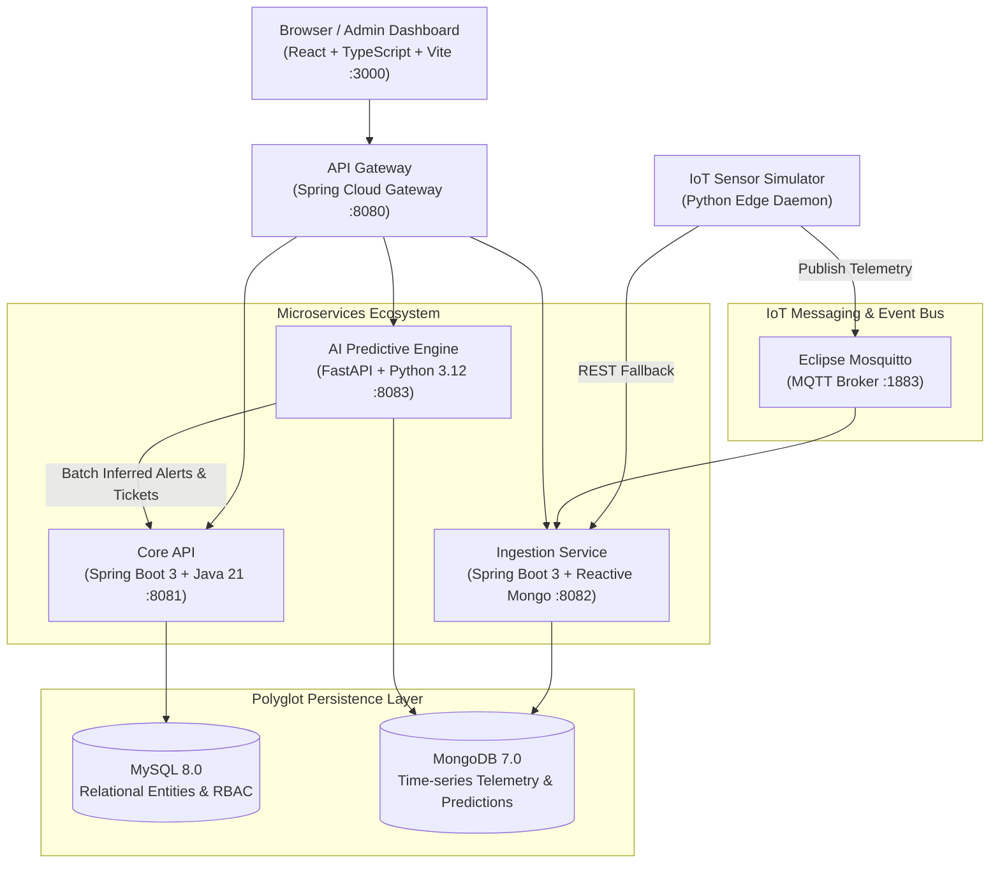

# Smart IoT Park Platform

[](https://github.com/xSenitha/smart-iot-park-platform/actions/workflows/ci.yml)
[](LICENSE)
[](https://www.oracle.com/java/)
[](https://spring.io/projects/spring-boot)
[](https://www.python.org/)
[](https://fastapi.tiangolo.com/)
[](https://react.dev/)
[](https://www.docker.com/)

> **A production-grade, distributed IoT management & predictive maintenance platform** designed for municipal city planners, park administrators, and field maintenance crews. Features real-time sensor ingestion, zone-level environmental monitoring, AI-driven failure/overflow forecasting, and automated maintenance ticketing.

---

## 🏗️ Architecture Overview

The platform uses a microservices architecture with polyglot persistence, event-driven messaging, and a centralized perimeter gateway:



---

## 🧩 Service Ecosystem & Technologies

| Service | Directory | Stack | Port | Responsibilities |
| :--- | :--- | :--- | :--- | :--- |
| **Admin Dashboard** | `frontend/dashboard` | React 18, TypeScript, Vite, CSS Modules | `3000` | Real-time map, sensor charts, alert toasts, ticket kanban |
| **API Gateway** | `services/api-gateway` | Spring Cloud Gateway, Reactive Java 21 | `8080` | Perimeter routing, JWT auth filter, CORS, rate limiting |
| **Core API** | `services/core-api` | Spring Boot 3, Java 21, Flyway, JPA | `8081` | Users, RBAC, Parks, Zones, Devices, Alerts, Tickets, SSE |
| **Ingestion Service** | `services/ingestion-service` | Spring Boot 3, Spring Data Mongo, MQTT | `8082` | MQTT consumer, REST intake, validation, MongoDB time-series |
| **AI Predictive Engine** | `services/ai-engine` | Python 3.12, FastAPI, Scikit-Learn | `8083` | Bin overflow forecast, equipment anomaly, irrigation score |
| **Sensor Simulator** | `services/sensor-simulator` | Python 3.12, Paho MQTT, Asyncio | - | Realistic multi-zone IoT fleet telemetry generator |
| **MQTT Broker** | `infra/docker/mosquitto` | Eclipse Mosquitto | `1883` | Lightweight pub/sub messaging for IoT edge telemetry |
| **Relational DB** | `infra/docker/mysql` | MySQL 8.0 | `3306` | Structured entity storage with ACID guarantees |
| **Time-Series DB** | `infra/docker/mongo` | MongoDB 7.0 | `27017` | High-frequency sensor log storage with TTL expiration |

---

## 🚀 Quickstart: Running Locally

### Prerequisites
- Docker Engine 24+ & Docker Compose v2+
- Git

### Launch the Entire Stack
```bash
# 1. Clone repository
git clone https://github.com/it24103788-sliit/smart-iot-park-platform.git
cd smart-iot-park-platform

# 2. Copy development environment configuration
cp .env.example .env

# 3. Spin up all containers in background
make up
```

Once started:
- 🌐 **Web Dashboard**: [http://localhost:3000](http://localhost:3000)
- 🚪 **API Gateway**: [http://localhost:8080](http://localhost:8080)
- 📖 **Core API Swagger UI**: [http://localhost:8081/swagger-ui.html](http://localhost:8081/swagger-ui.html)
- 🤖 **AI Engine Docs**: [http://localhost:8083/docs](http://localhost:8083/docs)
- 📊 **Prometheus Metrics**: [http://localhost:9090](http://localhost:9090)
- 📈 **Grafana Dashboards**: [http://localhost:3001](http://localhost:3001) (admin/admin)

### Demo Credentials
| Role | Username | Password | Access Scope |
| :--- | :--- | :--- | :--- |
| **Admin** | `admin` | `Admin123!` | Full municipal control, device creation, rule configuration |
| **City Planner** | `planner` | `Planner123!` | Park/Zone design, analytics, environmental metrics |
| **Maintenance Crew** | `maintenance` | `Tech123!` | Ticket assignment, device status updates, alert resolution |

---

## 🧪 Testing & Validation

Run all microservice tests with one command:
```bash
make test
```

Or test individual services:
- **Core API**: `cd services/core-api && ./mvnw test`
- **Ingestion Service**: `cd services/ingestion-service && ./mvnw test`
- **AI Engine**: `cd services/ai-engine && pytest`
- **Frontend**: `cd frontend/dashboard && npm test`

---

## 💼 What This Project Demonstrates (CV & Staff Engineer Competencies)

1. **Microservices & Clean Architecture**: Proper decomposition with decoupled bounded contexts, clean layers (Controller -> Service -> Repository -> Domain), DTO abstraction, and global RFC 7807 error envelopes.
2. **Polyglot Persistence Strategy**: Deliberate division between relational MySQL (referential integrity, complex queries, audit compliance) and document MongoDB (high-velocity time-series, TTL index data lifecycle, polymorphic sensor readings).
3. **IoT Telemetry Ingestion Pipeline**: Industrial-standard MQTT pub/sub integration combined with REST fallback, supporting edge-device backpressure, reconnect logic, and millisecond persistence.
4. **Pragmatic AI & Predictive Maintenance**: Productionized machine learning with explainable models (EWMA fill forecasting, multivariate Isolation Forest anomaly detection, automated ticket generation).
5. **Modern Reactive Frontend**: React 18 dashboard built with TypeScript and Vite, featuring custom glassmorphism design tokens, real-time SSE telemetry updates, interactive park zone mapping, and role-based route guards.
6. **Enterprise Security & Compliance**: BCrypt password hashing, stateless JWT authentication with token rotation, method-level RBAC (`@PreAuthorize`), and audit logging.
7. **Cloud Infrastructure as Code**: Full AWS Terraform modules for production EC2, VPC, security groups, and automated container orchestration.

---

## 📄 License
This project is licensed under the MIT License - see the [LICENSE](LICENSE) file for details.
